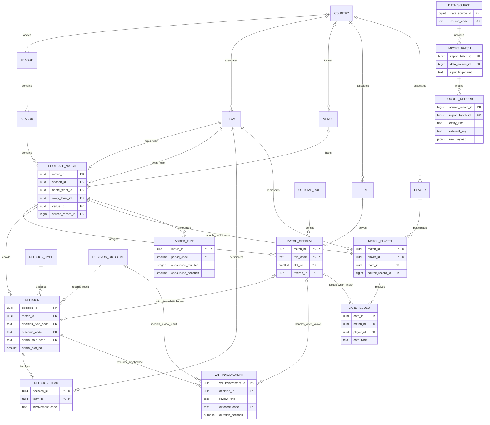

# Proposed ER diagram

Approval draft based on blueprint sections 5 and 9. All 20 required tables are retained. `MATCH_PLAYER` is one proposed supporting table for historically correct card/player/team validation. No SQL has been applied.

Country associations are optional where the source does not identify a country or a competition is international; the diagram's country edges describe the referenced relationship when present. A venue and recorded decision/review outcomes can also be unknown.

For readability, provenance edges to every operational table are omitted. Each imported operational row references the source record supporting its current version; `SOURCE_RECORD -> IMPORT_BATCH -> DATA_SOURCE` supplies the lineage. Raw records from prior batches remain retained. Exact source identity and raw locators allow earlier versions to be traced without duplicating provider fields throughout the schema.

The materialized view `mv_referee_stat_summary` derives statistics from matches, seasons, appointments, decisions, reviews and cards. It is a derived object rather than a separate entity. See the relational schema for composite keys, nullable attribution, trigger-enforced relationships and identity rules.
