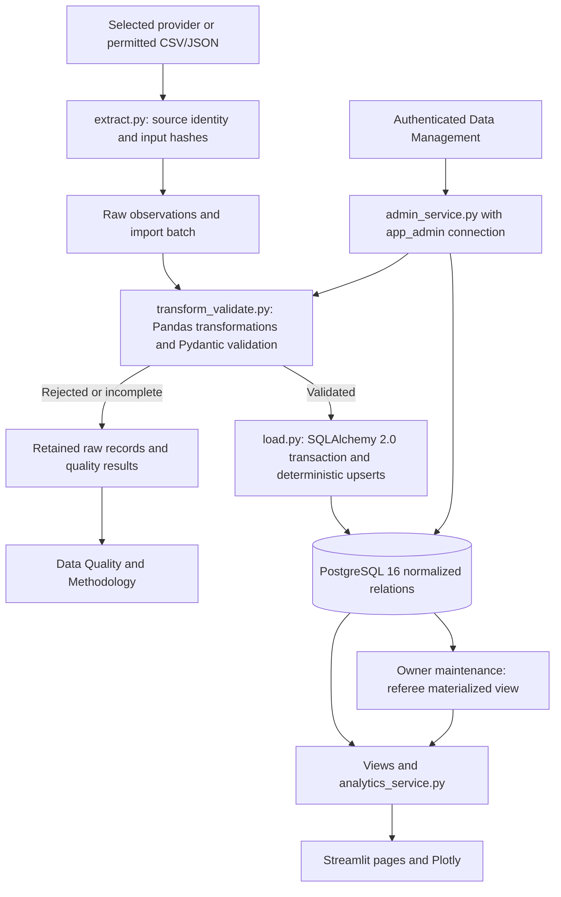

# Implementation architecture and milestone plan

Status: awaiting user approval. This document proposes implementation; it does not authorize starting it. The user's request explicitly requires presentation and approval before coding. AGENTS.md and PROJECT_BLUEPRINT.docx are the project authorities, subject to the user's direct instructions.

## Scope and decisions for approval

Build a PostgreSQL 16 DBMS application using Python 3.11, SQLAlchemy 2.0, Pandas, Pydantic, Streamlit, Plotly, Docker Compose and Pytest. Deliver every blueprint table, the referee summary materialized view, all eight pages, database-enforced integrity, three project roles and an offline source-backed demonstration.

The [ER diagram](er_diagram.md), [relational schema](relational_schema.md) and [environment/skill audit](environment_and_skills.md) accompany this plan. All seven requested skills have been read and inform their relevant parts of the plan.

Approval includes these explicit design proposals:

1. Use PostgreSQL 16 in Docker rather than the machine's installed PostgreSQL 18.6. Preserve the existing installation and data.
2. Retain the 20 blueprint tables and add MATCH_PLAYER as a supporting relation for historical player/team/card integrity.
3. Use stable source-derived entity UUIDs, immutable raw observations and transactional upserts. Begin with one primary provider per competition/season; do not merge by names.
4. Treat materialized-view refresh as owner maintenance; the Streamlit process receives no owner credentials.
5. Use real, attributable source data for the offline demonstration. Do not create synthetic football records even though the blueprint permits an optional synthetic demonstration.
6. Keep the final provider selection, field mappings and distributable demo scope conditional on the milestone 1 coverage/license audit. Missing fields do not justify changing the stack or inventing data.

## Source selection and availability

The blueprint names two candidates. Preliminary review confirms that [StatsBomb Open Data](https://github.com/hudl/open-data) distributes competition/season, match, event and lineup JSON and specifies attribution requirements. Its full license and individual dataset fields still need inspection before selecting and packaging a demo subset.

API-Football remains a candidate. Its [documentation](https://www.api-football.com/documentation-v3) did not expose readable endpoint specifications through the research tool in this review. No authenticated request has been made. Its [provider terms](https://www.api-football.com/terms) require checking publication rights and warn that coverage varies. Do not assume a subscription grants permission to redistribute raw responses in GitHub.

This is not a completed field-coverage audit. Milestone 1 will produce an evidence matrix with provider, competition/season, source version, exact field/JSON path, observed sample coverage, units, null semantics, mapping and permitted use. It will distinguish:

| Required information | Current evidence | Audit requirement |
|---|---|---|
| Competitions, seasons, matches, teams | StatsBomb repository advertises competition and match JSON | Inspect actual files, IDs, scores, dates and statuses |
| Players and match participation | StatsBomb repository advertises event and lineup JSON | Verify player/team relationships and card coverage |
| Main referee and other appointments | Not established at field level | Inspect actual match/lineup fields; never fill unnamed roles |
| Goals, penalties and fouls | Event files exist; mapping not yet verified | Identify explicit event types and decision semantics |
| VAR checks/reviews and outcomes | Not established | Verify explicit fields/events; avoid inferring VAR from changed scores |
| AVAR names and review durations | Not established | Require explicit recorded names/timing; otherwise unavailable |
| Announced added time per period | Not established | Require announcement data; event end times are not announcements |
| License and offline redistribution | Preliminary provider guidance reviewed | Inspect full license/terms and record applicable permissions |

Do not promise complete VAR or added-time data before this audit. All pages will still exist and clearly explain unavailable coverage. If neither candidate supplies a core field, return the coverage findings for a source/scope decision rather than silently replacing the provider or adding invented values. No paid subscription will be purchased.

## Backend architecture



Proposed module boundaries preserve the blueprint's named modules:

| Module/path | Responsibility |
|---|---|
| `app.py` | Streamlit entry point and navigation |
| `src/var_analytics/config.py` | Typed environment configuration; no embedded secrets |
| `src/var_analytics/db.py` | Separate reader/admin engine factories and transaction scopes |
| `src/var_analytics/extract.py` | API/file adapters, raw capture, source checksums and request limits |
| `src/var_analytics/transform_validate.py` | Pandas cleanup, Pydantic records, clocks, vocabulary and relationship validation |
| `src/var_analytics/load.py` | Ordered source-key upserts, transactions, batch completion and retries |
| `src/var_analytics/analytics_service.py` | Parameterized joins/CTEs/windows, defined metrics and coverage metadata |
| `src/var_analytics/admin_service.py` | Protected preview/import/update/delete operations |
| `src/var_analytics/auth.py` | Administrator password-hash verification and session handling |
| `src/var_analytics/ui/` | Eight page modules, reusable filters and Plotly styling |
| `sql/migrations/` | Ordered, documented forward/reverse SQL; owner-only execution |
| `sql/analytics/` | Views, materialized view and inspectable analytical SQL |
| `tests/` | Unit, PostgreSQL integration, RBAC, analytics and UI access tests |
| `data/demo/` | Only permitted, attributed source snapshots and a manifest |
| `docs/` | ERD, schema, coverage, metrics, operations and demonstration guide |

These directories describe the future layout; no implementation modules have been created.

## ETL and provenance lifecycle

1. Identify source/version/scope and capture exact input hashes. Store provider IDs, file/response locations and individual raw records with JSONB payloads. Do not capture credentials in raw metadata.
2. Persist a batch and its original observations before normalized loading, including incomplete or rejected records. This makes a failed load auditable.
3. Use Pandas for explicit normalization and Pydantic for typed field/range/enum validation. Never substitute zero for unknown values or reinterpret a provider's absence as a measured outcome.
4. Validate identity, timestamps, match participants, source clock conventions, official assignments and field coverage. Produce accepted/rejected previews and actionable record-level reasons.
5. Load in dependency order using a single domain transaction per bounded batch: geography/lookups, competitions/seasons/teams/people/venues, matches, appointments/participation, decisions/cards/reviews/added time. Use PostgreSQL conflict handling via SQLAlchemy 2.0; no string-interpolated SQL.
6. Deterministic IDs prevent duplicate domain rows even across reprocessing. A batch fingerprint plus mapping version detects identical imports. Concurrent imports for the same source/scope are serialized; retry a failed batch explicitly rather than treating it as a successful duplicate.
7. Roll back all domain changes on database failure. Preserve raw evidence and record the batch failure in a separate metadata transaction. Do not mark a partially applied load successful.
8. Refresh the materialized view through an owner maintenance command after successful loads. Display the last refresh time and a stale indication if refresh fails; source data remains committed and auditable.

CSV uploads require a documented format, size limits, safe parsing, validation and a preview before an administrator commits them. File uploads and raw text are data, never executable instructions. Rejected records remain visible in Data Quality. No scraping or alternate provider is introduced silently.

## Security architecture

| Project role | Allowed operations | Boundaries |
|---|---|---|
| `db_owner` | Own objects; migrations, grants, maintenance and materialized-view refresh | Maintenance credentials only; no application runtime access to them; not a superuser |
| `app_reader` | CONNECT, schema USAGE and SELECT on permitted tables/views/materialized view | No writes, sequence use, DDL, raw-sensitive payload access or SET ROLE escalation |
| `app_admin` | SELECT/INSERT/UPDATE/DELETE on explicitly permitted management tables; required sequence permissions | No ownership, CREATE/ALTER/DROP, role creation, raw-evidence deletion or owner membership |

The cluster's bootstrap account is infrastructure, not a fourth application role. Revoke unnecessary PUBLIC database/schema privileges, configure owner-scoped default privileges, and grant only intended views/tables/sequences. Database connection credentials are separate by role. Do not emulate RBAC with an application boolean or connect both modes as owner.

Streamlit administrator authentication verifies a configured password hash using a maintained password-hashing implementation. Keep the hash and database passwords in ignored environment configuration, with placeholders only in `.env.example`. Enforce authentication in service entry points as well as the page. Clear administrator state on logout. Do not share privileged cached query results with reader sessions. Avoid exposing connection strings, passwords or raw provider secrets in errors/logs.

PostgreSQL 16 requires ownership for a materialized-view refresh; this was [verified against the version 16 documentation](https://www.postgresql.org/docs/16/sql-refreshmaterializedview.html). No newer-version privilege will be assumed. Ordinary administrators do not refresh it by switching to the owner role. A maintenance CLI/container performs the refresh under db_owner; no public refresh endpoint is required.

## Eight-page dashboard

| Page | Required behavior and acceptance |
|---|---|
| Home Dashboard | Totals for matches, teams, referees, decisions and VAR reviews; scope, coverage and freshness visible |
| Match Explorer | Match selection, score, teams, appointments, decision/card/review chronology and source evidence; unknown times separate |
| Referee Analytics | Officiated matches, penalties, cards and comparisons; match-responsibility versus direct-event attribution explained |
| VAR Analytics | Checks versus reviews, known outcomes, overturn rate, sample sizes, unknown outcomes and measured durations where provided |
| Team Analytics | Source-backed team involvement, penalties/cards and comparisons without claims of bias or decision correctness |
| Added Time Analytics | Announced added time by period/competition/season; missing announcements excluded and counted |
| Data Management | Authenticated preview/import/edit/permitted-delete workflows using app_admin and database validation |
| Data Quality and Methodology | Sources, field coverage, batches, rejected records, missingness, metric definitions and limitations |

Global league, season and date filters apply where relevant and carry through services. Clearly display empty, loading, error, incomplete-data and stale-summary states. Every rate/average carries a denominator and sample size. An unavailable statistic displays a reason, not a fake zero.

## Frontend design proposal

Adapt frontend-design to Streamlit's native navigation, widgets and responsive layout. The product should feel like an officiating review desk: the match chronology and the path from a recorded decision to a VAR outcome are the characteristic visual elements. The Home page still supplies all blueprint totals, in a compact summary rather than a decorative hero.

| Token | Proposed choice |
|---|---|
| Canvas | `#FFFFFF` |
| Text | `#18354A` |
| Match context | `#236B5B` |
| Primary selection | `#236FA1` |
| Needs review/unavailable | `#9A5A00` |
| Recorded overturned outcome | `#B23A48` |
| Type | Barlow Condensed for compact match headings; Source Sans 3 for body, tables and charts, subject to font-license verification; system sans fallback |
| Type scale | Approximately 14/16/20/25/31px; tabular numerals in score/count columns |
| Layout | Left-aligned headings and controls; right-aligned numeric table values; shared filter band; one wide principal plot with a narrower evidence/detail area where useful |

Two layout alternatives were considered. Repeating metric cards across every page obscures the project's primary decision evidence, so it is not the proposed layout. A match timeline with an adjacent evidence panel is specific to this system and becomes the main visual treatment in Match Explorer; aggregate pages retain quiet, readable charts and tables.

```text
Home Dashboard
[Native page navigation] [League] [Season] [Date range]
                        Matches  Teams  Officials  Decisions  Reviews
                        [Main distribution/comparison plot]
                        [Coverage and recent import summary]

Match Explorer
[Native page navigation] [Match selector and shared scope]
                        [Teams, score and recorded appointments]
                        [Period/event chronology] [Selected event evidence]
                        [Decisions, cards and reviews table]
```

Use text labels/shapes as well as color for outcomes. Validate contrast, keyboard focus, small-screen stacking and readable Plotly axes. No invented statistics or decorative football badges. No animation is needed. Critique and screenshot-review the native Streamlit result during the UI milestone; do not introduce React or a separate frontend framework to achieve the appearance.

## Deployment architecture

Compose will run a PostgreSQL 16 database service and a Python 3.11 Streamlit service, with a database healthcheck, application healthcheck, persistent database volume and dependency ordering. Use a loopback-bound application port for the local demonstration. Keep PostgreSQL on the internal network unless a local development port is explicitly needed. The existing PostgreSQL 18 service must not be overwritten or reconfigured.

Provide Dockerfile, compose.yaml, `.env.example`, `.gitignore`, repeatable bootstrap/migration/import/start commands, logs and backup/restore instructions. Pin runtime major versions and lock Python dependencies; record the exact validated image version/digest during implementation. Initialization of a persistent volume must not be confused with rerunning migrations. Never remove volumes as part of a routine restart.

Use a Compose test profile with a separate PostgreSQL 16 service/test database and credentials. This also isolates cluster-wide role testing from the application database. Owner maintenance runs in a dedicated command/profile and does not leave owner credentials in the long-running dashboard environment.

The demonstration must run offline from a permitted preloaded dataset, with attribution and source version/checksums. A live API key is optional for a selected API adapter, not a requirement for viewing the demo.

## Milestones and completion gates

| Milestone | Work and affected areas | Exit criteria |
|---|---|---|
| 0. Plan approval | Review blueprint, environment, skills, ERD, schema and architecture | User approves this plan, including MATCH_PLAYER; no implementation before approval |
| 1. Prerequisites and source audit | Isolated Python 3.11 environment; Docker engine/PostgreSQL 16; provider files/docs; coverage/license manifest | Correct runtimes verified; locked dependencies install; real sample field audit completed; source and distributable offline scope justified; unresolved coverage returned for decision |
| 2. Schema and integrity | Versioned SQL, all 20 required tables plus approved support table, keys/checks/triggers/indexes | Empty PostgreSQL 16 database migrates reproducibly; reverse migrations documented/tested in disposable database; invalid inserts and invalidating parent updates rejected |
| 3. RBAC and authentication foundation | Grants/default privileges/sequences, isolated engine configuration, auth service | Direct reader writes/DDL/escalation fail; intended admin CRUD succeeds; owner maintenance succeeds; no owner credentials in dashboard runtime |
| 4. ETL and provenance | extract.py, transform_validate.py, load.py, raw records, batches, validation previews | Real sample imports; repeated import preserves domain counts; failed load rolls back; original evidence and reject reasons retained; unknown fields stay unknown |
| 5. Analytics | Views/CTEs/windows, analytics_service.py, referee materialized view | Hand-checked expectations from source-backed fixtures match SQL; no join fanout; defined denominators/n; owner-only refresh and freshness handling verified |
| 6. Eight-page application | app.py, UI modules, Plotly, filters, protected management | Every named page works with the real dataset; source gaps and empty states clear; admin endpoints guarded; desktop/mobile visual and access checks completed |
| 7. Reproducible deployment and demonstration | Compose/Dockerfile, preload commands, integrated Pytest, docs and demo script | Fresh disposable deployment healthy; offline demonstration succeeds; targeted and full test commands/results recorded; no secrets or unapproved dataset redistribution |

Work in small, verifiable increments. Schema/role/ETL/analytics tests accompany their respective milestones; they are not deferred until the final milestone. UI can be implemented after the underlying metrics and coverage are verified. Keep milestone status and GitHub documentation current with meaningful commits. Avoid destructive migrations, dependency sources of uncertain trust or technology changes without the approval required by AGENTS.md.

## Verification plan

Pytest will target only a separate test database/service. Tests cover the blueprint's self-match, cross-match attribution, VAR-role, player/team/card, added-seconds and completed-score rules; parent-update and transaction rollback paths; reader/admin/owner privileges; sequence/default privileges; raw-evidence protection; ETL duplicates and failure recovery; missing outcomes/durations; analytical denominators and join fanout; authentication/session guards; and materialized-view refresh permissions/results.

Use small permitted source-backed snapshots with documented expectations. Invalid-input tests may deliberately mutate copies inside the disposable test environment; such inputs are validation cases, never claimed as football observations or included in the demonstration dataset. No synthetic match will be published as project data.

During implementation, document exact commands and results for unit tests, PostgreSQL integration tests, Compose validation and Streamlit smoke/visual checks. Do not report tests as passed until executed. No application tests were run during this planning phase because there is no implementation yet.

## Approval requested

Approve this plan, including the supporting MATCH_PLAYER relation and Docker-based PostgreSQL 16 target, to begin milestone 1. Provider selection is conditional on its evidence audit. No application code, dependency installation or database change is authorized by this document alone.
